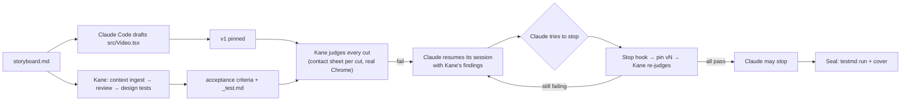

# dailies

**Every frame, proven.**

In September 2026, Claude Opus 5.5 started one-shotting motion design. A one-line prompt became a 15-second showreel; a founder shipped a product promo the model wrote in one pass ([Steven Tey](https://x.com/steventey/status/2103625902211088880): *“Claude Opus 5.5 feels like the first model to have truly solved video animation.”*). Video became code — a React file an agent writes, renders, and calls done.

And nobody reviews it. AI-written code got type checks, CI and Kane CLI clicking through the UI. AI-written video got someone scrubbing the timeline and saying *looks good*. So the call to action ships under the Reels buttons, the wordmark lands a second late, and the caption runs off the square cut.

**dailies** is test-driven video. You write a storyboard. **Claude Code** composes it as a Remotion composition. **Kane CLI** reads the same storyboard, designs the acceptance criteria and tests, and judges every cut, frame by frame, in a real browser — and through Claude Code’s Stop hook, Claude can’t call the video done until the storyboard holds.

Everyone used Kane to test their code. I’m a designer — I used it to test what the code makes.

> **Run it:** `npm install && npm run dev` → http://localhost:5173 · **Watch a recorded run with no install:** `VITE_DAILIES_STATIC=1 npm run build && npx vite preview apps/studio` · **Pitch:** `/pitch` · **Evidence:** [`docs/kane-runs/`](docs/kane-runs/)

## Table of contents

- [What it is](#what-it-is)
- [Who it is for](#who-it-is-for)
- [Lane](#lane)
- [Important links](#important-links)
- [Built with](#built-with)
- [Prerequisites](#prerequisites)
- [Quick start](#quick-start)
- [How it works](#how-it-works)
- [Kane CLI at the core](#kane-cli-at-the-core)
  - [Command map](#command-map)
  - [Plan: the storyboard becomes a test suite](#plan-the-storyboard-becomes-a-test-suite)
  - [Judge: one contact sheet per cut](#judge-one-contact-sheet-per-cut)
  - [Accuracy vs credits](#accuracy-vs-credits)
  - [Correct: the Stop-hook loop](#correct-the-stop-hook-loop)
  - [Connect your own Claude Code](#connect-your-own-claude-code)
  - [Seal: Kane’s own tests and coverage](#seal-kanes-own-tests-and-coverage)
  - [NDJSON, exit codes and credits](#ndjson-exit-codes-and-credits)
- [The failure Kane catches](#the-failure-kane-catches)
- [How this meets the brief](#how-this-meets-the-brief)
- [Studio tour](#studio-tour)
- [HTTP API](#http-api)
- [Recorded runs and the hosted replay](#recorded-runs-and-the-hosted-replay)
- [Honesty: limitations](#honesty-limitations)
- [Configuration](#configuration)
- [Repository layout](#repository-layout)

## What it is

A studio for video written as code, with two agents and one storyboard:

| | Claude Code | Kane CLI |
| --- | --- | --- |
| Reads | `storyboard.md`, `CLAUDE.md` (the composition contract) | `storyboard.md`, `surface.md` (where each cut can be inspected) |
| Produces | `src/Video.tsx` — one Remotion composition that renders every cut | acceptance criteria, scenarios and `*_test.md` files, cited to the storyboard |
| Then | fixes exactly what Kane reports, from inside its own session | judges every criterion on every cut, re-judges every fix, seals the evidence |

A full run is three buttons:

1. **Generate draft** — Claude Code writes the first draft while Kane CLI designs the tests from the same storyboard, in parallel. You watch Claude type the code and Kane commit criteria, live.
2. **Run Kane review** — Kane judges the draft. Failures resume Claude’s own session with Kane’s findings; every time Claude tries to stop, the workspace **Stop hook** sends the attempt back through Kane. Claude stops only when every check passes (or the round cap hands it to a human).
3. **Seal proof** — Kane replays its own designed tests against the final cut, writes evidence packs, and `kane-cli cover` reports which criteria are proven.

Then **Draft vs final** shows the one-shot draft and the Kane-corrected cut under a wipe, in lock-step, with every criterion’s verdict before and after.

## Who it is for

- **Designers and motion designers** using Claude Code (or Cursor, Codex…) to produce launch videos, promos and explainers as code — who need to know a cut is right without scrubbing three aspect ratios frame by frame.
- **Developers shipping their own launch and changelog videos** with an agent: the same rigor as their code, for the video about their code.
- **Performance marketers** producing variants per platform, where a CTA under the Reels UI is wasted spend.
- **Agencies** who sign off against a storyboard and want an evidence pack instead of “looks good”.

## Lane

**Lane 4 — Requirements that test themselves**, with Lane 1’s loop built in.

The storyboard *is* the PRD. `kane-cli context ingest` turns it into use-cases cited to its lines; `kane-cli design tests` produces acceptance criteria with oracles and one `_test.md` per scenario; `kane-cli cover` reports proven vs owed per criterion. On top of that, every criterion is judged on every cut after every change, and the result feeds straight back to the coding agent through Claude Code’s Stop hook — the app verifies itself.

## Important links

| | |
| --- | --- |
| **Demo video** | coming soon |
| **Replay (no install)** | static build of the studio — recorded runs play back with their real timing ([how](#recorded-runs-and-the-hosted-replay)) |
| **Pitch** | `/pitch` in the studio |
| **Recorded runs** | [`apps/studio/public/recorded/`](apps/studio/public/recorded/) — events, versions, Kane’s-eye screenshots, designed tests |
| **Kane evidence** | [`docs/kane-runs/`](docs/kane-runs/) — rounds, conditions, verdicts, seal results |

## Built with

Built with **Claude Code** (model **Claude Opus 5.5**) as the coding agent. The studio’s own drafting agent is also Claude Code, run headless.

| Tool | Role |
| --- | --- |
| **Kane CLI** 0.10.5 | Designs the tests (`context`, `design`), judges every cut (`run --analyzer-only --cdp-endpoint`), seals evidence (`testmd run`, `cover`) |
| **Claude Code** (`claude -p`, stream-json) | Writes and corrects `src/Video.tsx`; its Stop hook is the closed loop |
| **Remotion** 4 (`remotion`, `@remotion/player`) | Plays compositions and renders exact frames (`Thumbnail`) for the contact sheets |
| **React 19 + Vite** | The studio |
| **Fastify** | Job API, SSE event stream, Stop-hook endpoint |
| **esbuild** | Compiles each version of Claude’s composition into a module the studio imports at runtime |
| **playwright-core** | Only opens Chrome with a CDP port and navigates it to a sheet; Kane does the judging |
| **Google Chrome** | The browser Kane judges in |

## Prerequisites

- Node.js 20+ and Google Chrome
- Claude Code installed and logged in (`claude --version`)
- Kane CLI installed and logged in: `npm i -g @testmuai/kane-cli && kane-cli login`
- macOS or Linux

## Quick start

```bash
npm install
npm run dev          # server :4100 + studio :5173
open http://localhost:5173
```

1. **New spot** → pick the *Product launch* template → **Create project**.
2. **Generate draft** — watch Claude Code type the composition while Kane designs the tests.
3. **Run Kane review** — watch Kane judge 3 cuts in parallel, Claude get blocked, fix, and Kane release it.
4. **Draft vs final** — wipe between the one-shot draft and the corrected cut.

Keyboard in the studio: `Space` play/pause, `←/→` frame step (`Shift` = 1s), `1–3` cut, `Z` safe zones, `X` layer X-ray.

```bash
npm test             # storyboard parsing, frame sampling, criterion mapping (no credits)
npm run typecheck
```

## How it works



In plain English, end to end:

1. **You write the storyboard** — shots with timecodes, exact copy, cuts and constraints, in markdown.
2. **dailies lays out a workspace** — `storyboard.md`, a `CLAUDE.md` contract (Remotion only, one component for every cut, name every text layer with `data-layer`), a `surface.md` describing the inspection pages, and a `.claude/settings.json` Stop hook.
3. **Claude Code drafts** — `claude -p` in the workspace with `--include-partial-messages`; the studio shows the code as it is typed and hot-swaps the player on every edit.
4. **Kane designs the tests at the same time** — ingest, approve, design: acceptance criteria with oracles, scenarios, `*_test.md`.
5. **The draft is pinned as v1** — compiled with esbuild; every verdict is tied to a pinned version.
6. **Kane judges** — for each cut, dailies opens a contact sheet (every storyboard timecode in one viewport, plus a facts table measured in the browser) in a Chrome with a CDP port, and Kane answers every criterion for that cut in one `--analyzer-only` call. Cuts run in parallel.
7. **Claude corrects** — failures resume Claude’s draft session with Kane’s verdicts, the storyboard lines they cite, the sheet’s measured evidence and the path to Kane’s screenshot.
8. **The Stop hook closes the loop** — every attempt to stop pins a new version; Kane re-judges only what failed, then sweeps everything for regressions; failures go back as the hook’s block reason.
9. **Seal** — Kane replays its own designed tests and `cover` reports coverage.

## Kane CLI at the core

Everything that decides whether a frame is right is Kane CLI. dailies opens pages and keeps score.

### Command map

| Kane CLI | When | Source |
| --- | --- | --- |
| `whoami`, `balance`, `--version` | Studio health, credit display | [`kane.ts`](apps/server/src/kane.ts) `kaneIdentity` |
| `context ingest storyboard.md --as storyboard --mode agent` | Generate (parallel to Claude) | [`plan.ts`](apps/server/src/plan.ts) `buildPlan` |
| `context ingest surface.md --as surface --mode agent` | Generate | same |
| `context list --all --json` | Read use-cases, criteria, scenarios, gaps | same |
| `context review --approve <uc…> --mode agent` | Promote extracted use-cases to trusted | same |
| `design tests --use-case <uc> --mode agent --max 8` (+ resume on pause) | Criteria, scenarios, `*_test.md` | same |
| `maintain reconcile --from storyboard.md --source-id storyboard --mode agent` | Storyboard edited after planning | same |
| `run --analyzer-only --agent --cdp-endpoint http://127.0.0.1:<port> --condition …×N` | Every verification round, one call per cut | [`kane.ts`](apps/server/src/kane.ts) `analyze`, [`verify.ts`](apps/server/src/verify.ts) `runRound` |
| `testmd run .testmuai/tests/<t>_test.md --agent --headless --on-lock-conflict wait` | Seal | [`pipeline.ts`](apps/server/src/pipeline.ts) `startSeal` |
| `cover --json` | Seal: proven vs owed per criterion | same |

Every process is spawned with `shell: false`, `KANE_CLI_USER_AGENT=dailies`, NDJSON parsed line by line, and streamed into the studio ([`kane.ts`](apps/server/src/kane.ts) `kane`).

### Plan: the storyboard becomes a test suite

Kane’s design engine needs to know *where* a requirement can be observed. Given only the storyboard, it correctly refuses to invent a surface: in our first spike it produced 21 acceptance criteria and five scenarios, but every test was blocked by a `gap` (“Portrait preview surface”). dailies therefore ingests a second source, [`surface.md`](apps/server/src/templates.ts) — the contract of the inspection page — and Kane’s designed tests then open real pages:

```markdown
## Step 1 @verifies ac-8, ac-9
Open {{sheet_url}}?cut=9x16 in the browser and wait for the contact sheet header to say ready;
read its vertical-cut header, then assert duration is 12 seconds and frame rate is 30 fps.
```

`{{sheet_url}}` lives in `.testmuai/variables/assurance.json`; dailies points it at the version being sealed.

Kane’s criteria are shown in the studio with their oracle (`equals "€149"`), risk, the storyboard line they map to, and the designed tests whose steps `@verifies` them.

### Judge: one contact sheet per cut

`/inspect/<project>/<version>/sheet?cut=9x16` ([`Inspect.tsx`](apps/studio/src/pages/Inspect.tsx)) is the page Kane looks at:

- **Header:** measured pixel size, fps, duration, and the shots as the composition declares them.
- **Text placement report:** every *visible* text layer that leaves the frame or touches a reserved band (“bottom 35% band: caption “Run the city” at F2, F3”).
- **Frames:** one Remotion `Thumbnail` per storyboard timecode — shot openings, middles, closes, and every moment the storyboard names (“by 0:05”) — sized so the whole cut fits one screenshot, each labelled `F4 · 0:03`, with a per-frame flag line.
- **Facts table** (below the fold, read from the DOM): layer, kind, rendered text, visible, fully inside frame, touches top/bottom/side band, box. Text layers are measured by their glyphs (a DOM `Range`), not their element box.
- `data-ready="true"` once every frame has rendered.

dailies opens that page in a headless Chrome with a CDP port, then runs:

```bash
kane-cli run --analyzer-only --agent --cdp-endpoint http://127.0.0.1:9342 \
  --condition "[ac-23] On the 9:16 cut, no text or button occupies the bottom 35% of the frame. This sheet shows only the 9:16 cut (1080x1920)…" \
  --condition "[ac-14] The shot 2 price tag reads exactly “€149”. … Read exact wording from the facts table Text column…" \
  …
```

`condition_results` come back as `true | false | null` with Kane’s reason for each; dailies maps them to pass / fail / unjudged. The conditions are built in [`criteria.ts`](packages/shared/src/criteria.ts) `conditionFor`: the criterion text verbatim, the frames that matter, and which instrument on the page to trust.

Why the facts table: in a spike, Kane’s vision read a hero image saying **“Run the ctiy” as “Run the city”** three times out of three. Overlay text in a composition is real DOM text, so exact-copy criteria are judged from strings, not pixels. Vision is used where it is strong — what a frame shows, colour, whether something is visible.

### Accuracy vs credits

| Choice | Effect |
| --- | --- |
| One contact sheet per cut | every criterion for that cut in **one** analyzer call |
| Facts table + placement report | exact copy and positions read as strings; no OCR re-tries |
| Cuts judged in parallel (one Chrome per cut) | a full sweep of 62–69 checks in 40–58 s |
| Targeted re-check after a fix | only the failed checks are re-judged (1 condition: 4–6.5 credits, 9–21 s) |
| Regression sweep only when targeted checks pass | catches what a fix broke, once |
| Seal is opt-in | authoring Kane’s own tests is the expensive step; replays are free |

Measured on the recorded launch spot ([`docs/kane-runs/kestrel-runner-launch-spot-a3eb`](docs/kane-runs/kestrel-runner-launch-spot-a3eb/README.md)):

| Round | Kind | Version | Pass | Kane calls | Credits | Time |
| --- | --- | --- | --- | --- | --- | --- |
| r1 | full sweep | v1 (Claude’s draft) | 61/62 | 6 | 64.4 | 40 s |
| r2 | targeted | v2 (Claude’s fix) | 1/1 | 1 | 5.6 | 21 s |
| r3 | regression | v2 | 62/62 | 6 | 76.0 | 49 s |

Designing the 24 criteria and 5 tests from the storyboard cost 25 credits. A full sweep costs about one credit per check — every criterion on every cut, judged in a real browser.

### Correct: the Stop-hook loop

Every workspace has `.claude/settings.json`:

```json
{ "hooks": { "Stop": [{ "hooks": [{ "type": "command", "command": "node …/packages/hook/stop.mjs", "timeout": 1500 }] }] } }
```

[`stop.mjs`](packages/hook/stop.mjs) hands each stop attempt to the server ([`pipeline.ts`](apps/server/src/pipeline.ts) `onStopHook`), which:

1. pins `src/` as a new version (no change → tells Claude it hasn’t fixed anything yet);
2. refuses to judge code that does not compile (and says why);
3. has Kane re-judge only the failed checks (**targeted**), then everything (**regression**) once those pass;
4. answers with Claude Code’s contract — `{"decision":"block","reason":"<what Kane saw>"}` keeps Claude working; an empty answer lets it stop;
5. caps the loop (`DAILIES_MAX_FIX_ROUNDS`, default 4) and fails **open** on infrastructure errors, so a broken Chrome never traps the agent.

The block reason Claude receives is built in [`templates.ts`](apps/server/src/templates.ts) `correctionPrompt`: each failing criterion with Kane’s words, the storyboard line it cites, the sheet’s measured placement report, and the path to Kane’s screenshot — which Claude opens with its own `Read` tool to see exactly what Kane saw.

Claude Code is spawned with `--setting-sources project --strict-mcp-config --tools Read,Edit,Write,Glob,Grep`: only the workspace’s hook applies, never the user’s global hooks or MCP servers.

### Connect your own Claude Code

Toggle **Connect your Claude Code** in the studio and run, in a second terminal:

```bash
cd workspaces/<project> && claude
```

The toggle writes `.dailies-gate`; the same Stop hook then gates *your* interactive session: whatever you ask Claude to change, it can’t end its turn until Kane passes the cut — and the studio shows the rounds live ([`pipeline.ts`](apps/server/src/pipeline.ts) `onGatedStop`).

### Seal: Kane’s own tests and coverage

**Seal proof** runs every Kane-designed `_test.md` with `kane-cli testmd run` against the final version (one at a time — they share the workspace’s store lock), keeps each test’s TestMu share link and the reason of its first failing step from `output-<test>/Result.md`, then runs `kane-cli cover --json`. The Proof tab shows per-criterion coverage states (`proven`, `failing`, `not_designed`).

### NDJSON, exit codes and credits

- `run --analyzer-only`: verdicts from `run_end.condition_results` / `condition_reasons`; exit 0 means *judged*, not *true*.
- `testmd run`: verdict from `test_md_done.overall_status`, not the first `run_end`.
- Assurance commands (`--mode agent`): `agent_activity`, `usage`, `commit`, `receipt`, `session_paused`, `done` are streamed into the Kane feed; `session_paused` is answered with Kane’s own recommended defaults.
- Credits are read from `run_end.credits_consumed` **or** `credits`, and from assurance `usage.total_credits` — Kane versions disagree on the name.

## The failure Kane catches

Everything below is real output from the recorded run [`kestrel-runner-launch-spot-a3eb`](docs/kane-runs/kestrel-runner-launch-spot-a3eb/README.md) (Claude Code, `claude-opus-5-5`; Kane CLI 0.10.5). Nothing was planted.

Claude’s one-shot draft looks finished in every cut. On the **9:16** cut, it parks the **KESTREL** wordmark in the bottom 35% of the frame — exactly where Reels and TikTok draw their caption and buttons — in shot 2. The contact sheet Kane judged reported it:

```text
TEXT PLACEMENT REPORT · 9:16
Visible text in the bottom 35% band: wordmark “KESTREL” at F6, F7, F8, F9
```

Kane failed the criterion it had derived from storyboard line 20:

```text
r1 · v1 · ac-24 @ 9:16 — FAIL
No text or button occupies the bottom 35% of the 9:16 cut's frame.
Checking the text placement report for bottom-band text: value: 'false' -> 'false'; equals 'true' -> FAIL
```

Claude’s session resumed with Kane’s verdict, the storyboard line, the sheet’s measured report and the path to Kane’s screenshot. Claude moved the wordmark out of the band (v2, +4 −2) and tried to stop. The Stop hook pinned v2; Kane re-judged the one failed check (pass, 5.6 credits), then everything (62/62), and released Claude:

```text
Kane CLI verified v2: every criterion passes in every cut.
```

In the studio this is the **Corrections** card, the red pin on the 9:16 lane turning green, and **Draft vs final** opening on frame F6 with the wipe between the two.

The other recorded runs show the rest of the product honestly:

| Recorded run | What happened |
| --- | --- |
| `kestrel-runner-launch-spot-a3eb` | Draft 61/62 → Kane caught the 9:16 band violation → Claude fixed → 62/62 |
| `kestrel-runner-launch-spot-30d2` | Draft 65/65 on first sweep; **sealed**: 7/7 Kane-designed tests passed, `cover` 25/25 criteria proven (399 credits to author) |
| `ledgerline-instant-exports-0525` | Feature-announcement spot, draft 33/33 — Kane proved it, nothing to correct |
| `kestrel-runner-launch-spot-477c` | Three change requests (“big lower-third subtitle”, “full-width install bar pinned to the bottom”, “type 60% bigger”), each gated by a full Kane sweep: 69/69 every time — Claude worked around the 9:16 rule itself, and Kane proved it |

## How this meets the brief

- **Ships.** A working studio: storyboard in, a playable, verified composition in three cuts out. The static build replays the recorded runs with no install.
- **Verified.** Kane exercised every cut of every version: 125 checks in 13 analyzer calls on the showcase run alone, plus a sealed run where Kane’s own designed tests proved 25/25 criteria. It caught a real defect in Claude Opus 5.5’s one-shot draft — text inside the 9:16 bands the platform covers — and proved the fix. The rounds, conditions, verdicts and Kane’s screenshots are committed.
- **Closed loop.** Claude Code’s Stop hook *is* the loop: Claude tries to stop → Kane re-judges → the failure is the block reason → Claude edits → Kane again. The studio shows that moment live; the same hook gates a developer’s own `claude` session.
- **Craft.** Kane isn’t testing an app here — it’s reviewing what an agent *made*. The contact sheet, the facts table that keeps Kane honest about exact copy, the credit strategy, the code streaming in while Kane designs the tests, and a timeline whose pins are Kane’s verdicts.

## Studio tour

| Surface | What it shows |
| --- | --- |
| **Home** | Projects with posters rendered from the latest version and their draft → final score |
| **New spot** | Storyboard editor with templates and a live preview of what dailies parses and which frames Kane will judge |
| **Studio** | Storyboard (lines lit by their criteria’s verdicts) · Player (cut tabs, versions, LIVE, safe zones, X-ray) · Timeline (storyboard shots, composed shots, Kane’s frames, one lane of verdict pins per cut) · Live (round board + Claude Code and Kane CLI feeds) · Corrections · Criteria · Proof · Kane’s eye · Code diff |
| **Draft vs final** | Wipe or side-by-side in lock-step, scores before/after, every criterion’s verdict on both |
| **Contact sheet** | The page Kane judges |
| **Pitch** | `/pitch` |

## HTTP API

| Method | Path | Role |
| --- | --- | --- |
| `GET` | `/api/health` | Claude Code version, Kane version, user, credits |
| `GET` / `POST` | `/api/projects` | List / create from a storyboard |
| `GET` / `PATCH` | `/api/projects/:id` | Project / title, gate |
| `PUT` | `/api/projects/:id/storyboard` | Edit the storyboard |
| `POST` | `/api/projects/:id/draft` · `review` · `seal` · `cancel` | Run a stage |
| `GET` | `/api/projects/:id/events` | SSE (history, then live) |
| `GET` | `/api/projects/:id/events.json` | Full event log |
| `GET` | `/api/projects/:id/module/:v` | Compiled composition (version number or `live`) |
| `GET` | `/api/projects/:id/source/:v` · `diff/:a/:b` | Source and diffs |
| `GET` | `/api/projects/:id/files/eye/*` | Kane’s-eye screenshots |
| `GET` | `/api/projects/:id/tests` | Kane-designed `_test.md` files |
| `POST` | `/api/hook/stop` | Claude Code Stop hook |

## Recorded runs and the hosted replay

Every event is appended to `workspaces/<id>/runs/events.ndjson`. [`scripts/export-recorded.ts`](scripts/export-recorded.ts) exports a finished run — project, events, compiled versions, diffs, Kane’s-eye screenshots, designed tests — to `apps/studio/public/recorded/`, and

```bash
VITE_DAILIES_STATIC=1 npm run build
```

produces a static studio that replays the run with its real rhythm (play, 1×–20×, skip to result). No Claude Code, Kane CLI or server needed to watch it.

## Honesty: limitations

- **Kane sees frames, not motion or sound.** It judges sampled frames: every timecode the storyboard names, plus each shot’s opening and close. A glitch between two sampled frames can slip through, and audio is out of scope.
- **The facts table is dailies’ own measurement.** It is the browser’s real layout (`getBoundingClientRect`, a DOM `Range` for glyphs, computed font size), but dailies wrote the code that reads it. Kane judges the criterion against it and the picture. Vision alone was not reliable for exact copy: in a spike it read “Run the ctiy” as “Run the city” three times out of three.
- **Kane is not infallible, and neither was the first version of the sheet.** In early runs, Kane passed a 9:16 safe-zone criterion that the facts contradicted, and failed a “three cuts’ dimensions” criterion on a one-cut sheet. Both came from ambiguous instruments and conditions, which are now fixed: per-band columns, a placement report, and conditions that say “judge only this cut”. Separately, element-box measurement once reported a centred caption as touching the side bands; text is now measured by its glyphs.
- **Kane can be wrong too.** In an unrecorded run, a regression sweep failed “all text stays inside the frame” on the 1:1 cut while the sheet’s own report said no text left the frame. Claude was sent back once more for a likely false positive. The correction prompt includes the measured report, so Claude can see the contradiction, and the round cap bounds the cost.
- **One-shot drafts are not always wrong.** Across six launch-spot drafts in development, Kane failed four on their first sweep — three put text inside the 9:16 platform bands, one missed the €149 tag at 0:06 — and two were clean; the feature spot was clean. When asked for changes that pressure the rule, Claude worked around it by itself (69/69 three times). The value is that you don’t have to find out which kind of run you got by watching it.
- **A designed test can be stricter than the storyboard.** In one seal, Kane’s own test asserted the price tag on the 0:03 frame, but the storyboard only requires it at 0:04 and 0:06, so the test failed for a reason that wasn’t the video. The Proof tab shows each test’s failing step and Kane’s reason so you can tell the difference.
- **Seal is the expensive step.** Authoring Kane’s own tests cost about 400 credits for 7 tests on the launch spot. Replays are free. The review loop is cheap by comparison (see [Accuracy vs credits](#accuracy-vs-credits)).
- **Kane runs locally.** It needs Chrome and a Kane login, so the hosted studio replays recorded runs instead of running Kane.
- **Compositions are limited to React + Remotion**, with no external assets, so dailies can compile and render every version deterministically.

## Configuration

See [`.env.example`](.env.example).

| Variable | Default | Purpose |
| --- | --- | --- |
| `DAILIES_PORT` | `4100` | API port |
| `DAILIES_STUDIO_URL` | `http://localhost:5173` | Where Kane’s Chrome opens the sheets |
| `DAILIES_CLAUDE_MODEL` | `opus` | Model for the drafting agent |
| `CHROME_PATH` | system Chrome | Browser for the sheets |
| `DAILIES_CDP_PORT` | `9341` | First CDP port (one per cut) |
| `DAILIES_MAX_CONDITIONS` | `14` | Conditions per analyzer call before a sheet is split |
| `DAILIES_MAX_FIX_ROUNDS` | `4` | Stop-hook rounds before handing back to a human |

## Repository layout

```text
apps/server            Fastify API, Claude Code runner, Kane runner, verification rounds, Stop-hook endpoint
apps/studio            React studio, contact sheet, compare, pitch
packages/shared        Storyboard parser, frame sampling, criterion mapping, Kane condition builder (+ tests)
packages/hook          Claude Code Stop hook (stop.mjs)
scripts                export-recorded.ts
workspaces/<id>        One per project: storyboard, CLAUDE.md, surface.md, src/, versions/, runs/, .testmuai/ (gitignored)
docs/kane-runs         Committed evidence from the recorded runs
```
