<p align="center"></p>

<p align="center"><b>Every frame, proven.</b> · <a href="https://daohbofm7o9ia.cloudfront.net/">Live site</a> · <a href="https://daohbofm7o9ia.cloudfront.net/media/dailies-ad.mp4">Watch the film</a></p>

In September 2026, Claude Opus 5.5 started one-shotting motion design. A one-line prompt became a 15-second showreel. A founder shipped a product promo the model wrote in a single pass ([Steven Tey](https://x.com/steventey/status/2103625902211088880): *“Claude Opus 5.5 feels like the first model to have truly solved video animation.”*). Video became code: a React file an agent writes, renders and calls done.

And nobody reviews it. AI-written code got type checks, CI and Kane CLI clicking through the UI. AI-written video got someone scrubbing the timeline and saying *looks good*. So the wordmark ships under the Reels buttons, the price tag lands a second late, and the caption runs off the square cut.

**dailies is test-driven video.** You write a storyboard. **Claude Code** composes it as a Remotion composition. **Kane CLI** reads the same storyboard, designs the acceptance criteria and tests, and judges every cut, frame by frame, in a real browser. Through Claude Code’s Stop hook, Claude can’t call the video done until the storyboard holds.

Everyone used Kane to test their code. I’m a designer, and I used it to test what the code makes.

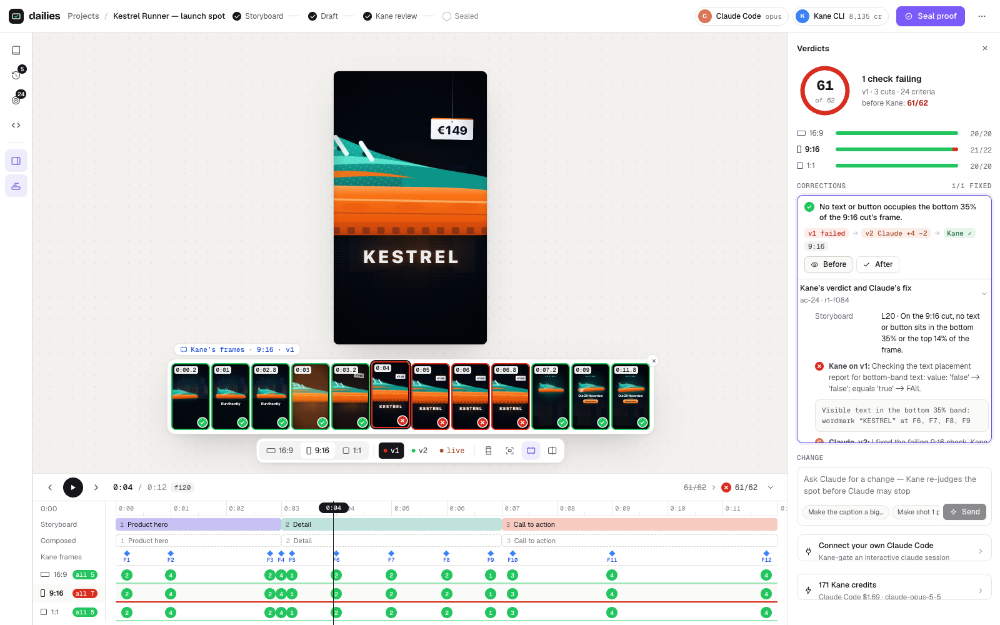

<sub>A real recorded run. Claude Opus 5.5’s draft put the KESTREL wordmark in the bottom 35% of the 9:16 cut, where Reels and TikTok draw their UI. Kane failed it on F6–F9, Claude fixed it, and Kane re-verified.</sub>

## Table of contents

- [What it is](#what-it-is)
- [Who it is for](#who-it-is-for)
- [Lane](#lane)
- [Important links](#important-links)
- [How to demo (3 minutes)](#how-to-demo-3-minutes)
- [Built with](#built-with)
- [Prerequisites](#prerequisites)
- [Quick start](#quick-start)
- [How it works](#how-it-works)
- [Kane CLI at the core](#kane-cli-at-the-core)
  - [Command map](#command-map)
  - [Plan: the storyboard becomes a test suite](#plan-the-storyboard-becomes-a-test-suite)
  - [Judge: one contact sheet per cut](#judge-one-contact-sheet-per-cut)
  - [Accuracy vs credits](#accuracy-vs-credits)
  - [Correct: the Stop-hook loop](#correct-the-stop-hook-loop)
  - [Ask for a change, connect your own Claude Code](#ask-for-a-change-connect-your-own-claude-code)
  - [Seal: Kane’s own tests and coverage](#seal-kanes-own-tests-and-coverage)
  - [NDJSON, exit codes and credits](#ndjson-exit-codes-and-credits)
- [The failure Kane catches](#the-failure-kane-catches)
- [How this meets the brief](#how-this-meets-the-brief)
- [The studio](#the-studio)
- [Brand](#brand)
- [The film](#the-film)
- [Deploy (AWS)](#deploy-aws)
- [HTTP API](#http-api)
- [Recorded runs and the static replay](#recorded-runs-and-the-static-replay)
- [Honesty: limitations](#honesty-limitations)
- [Configuration](#configuration)
- [Repository layout](#repository-layout)

## What it is

A light, minimal video editor for video written as code, with two agents and one storyboard:

| | Claude Code | Kane CLI |
| --- | --- | --- |
| Reads | `storyboard.md` and `CLAUDE.md` (the composition contract) | `storyboard.md` and `surface.md` (where each cut can be inspected) |
| Produces | `src/Video.tsx`: one Remotion composition that renders every cut | acceptance criteria, scenarios and `*_test.md` files, cited to the storyboard |
| Then | fixes exactly what Kane reports, inside its own session | judges every criterion on every cut, re-judges every fix, seals the evidence |

A full run is three buttons:

1. **Generate draft.** Claude Code writes the first draft while Kane CLI designs the tests from the same storyboard, in parallel. You watch Claude type the code on one side and Kane’s criteria land on the other.
2. **Run Kane review.** Kane judges the draft. Failures resume Claude’s own session with Kane’s findings. Every time Claude tries to stop, the workspace **Stop hook** sends the attempt back through Kane. Claude stops only when every check passes, or when the round cap hands the spot to a human.
3. **Seal proof.** Kane runs its own designed tests against the final cut, writes evidence packs, and `kane-cli cover` reports which criteria are proven.

Then **Before vs after** plays the version Kane failed and the corrected cut in lock-step under a wipe, with every criterion’s verdict on both.

## Who it is for

- **Designers and motion designers** using Claude Code (or Cursor, Codex…) to make launch videos, promos and explainers as code, who need to know a cut is right without scrubbing three aspect ratios frame by frame.
- **Developers shipping their own launch and changelog videos** with an agent: the same rigor as their code, for the video about their code.
- **Performance marketers** making variants per platform, where a call to action under the Reels UI is wasted spend.
- **Agencies** who sign off against a storyboard and want an evidence pack instead of “looks good”.

## Lane

**Lane 4, “Requirements that test themselves”, with Lane 1’s loop built in.**

The storyboard is the PRD:

- `kane-cli context ingest` turns it into use-cases cited to its lines.
- `kane-cli design tests` produces acceptance criteria with oracles, plus one `_test.md` per scenario.
- `kane-cli cover` reports proven vs owed for each criterion.

On top of that, Kane judges every criterion on every cut after every change. The result goes straight back to the coding agent through Claude Code’s Stop hook, so the app verifies itself.

## Important links

| | |
| --- | --- |
| **Live site** (recorded runs replay, no install) | [daohbofm7o9ia.cloudfront.net](https://daohbofm7o9ia.cloudfront.net/) |
| **The film** (2:13 ad + walkthrough) | [daohbofm7o9ia.cloudfront.net/media/dailies-ad.mp4](https://daohbofm7o9ia.cloudfront.net/media/dailies-ad.mp4) |
| **Pitch** | [`/pitch`](https://daohbofm7o9ia.cloudfront.net/pitch) ([preview](docs/media/11-pitch.png)) |
| **Brand kit** | [`/brand`](https://daohbofm7o9ia.cloudfront.net/brand) · source in [`brand/`](brand/) |
| **Recorded runs** | [`apps/studio/public/recorded/`](apps/studio/public/recorded/): events, versions, Kane’s-eye screenshots, designed tests |
| **Kane evidence** | [`docs/kane-runs/`](docs/kane-runs/): every round, condition and verdict, readable on GitHub |
| **Showcase run** | [`docs/kane-runs/kestrel-runner-launch-spot-a3eb`](docs/kane-runs/kestrel-runner-launch-spot-a3eb/README.md) |

## How to demo (3 minutes)

You need Node 20+, Chrome, Claude Code logged in and Kane CLI logged in (see [Prerequisites](#prerequisites)).

```bash
npm install
npm run dev            # API :4100 + studio :5173
open http://localhost:5173
```

**1. Try the demo storyboard.** On the home page, press **Try the demo storyboard**. It creates the demo spot (the storyboard behind the recorded catch-and-fix runs) and starts both agents. To read or edit it first, use **New spot**: the ★ Demo spot template is preselected.

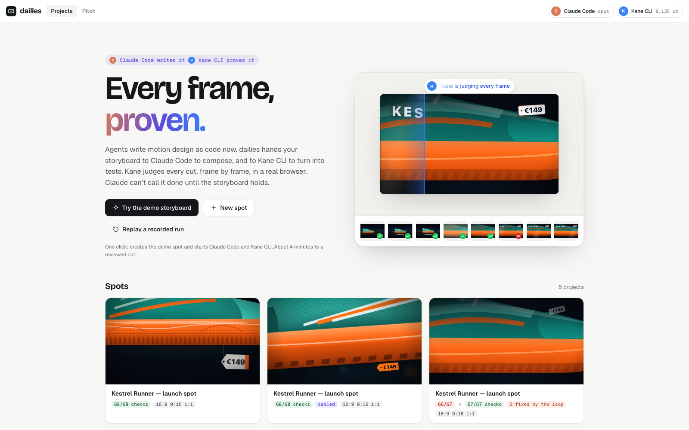

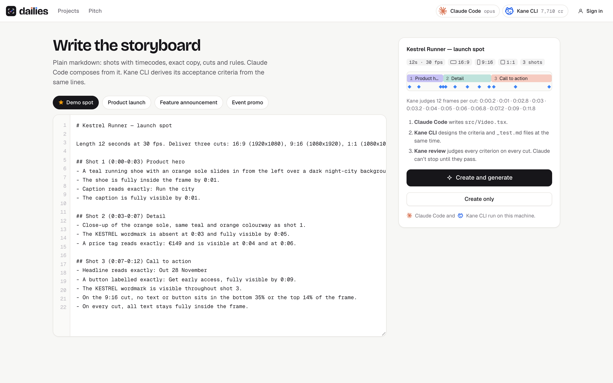

**2. Watch both agents work at once (about 3–5 minutes).**
- On the left, Claude Code’s code streams in as it is typed.
- On the right, Kane CLI’s acceptance criteria land as `design tests` commits them.
- The status pill at the top says what each agent is doing. Click it to open the live trace.

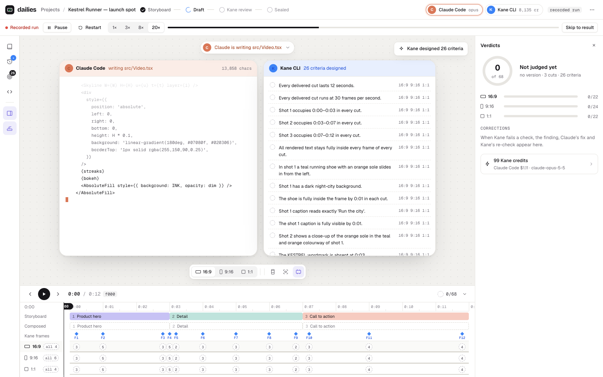

**3. Run Kane review.** Press **Run Kane review** (top right).
- Kane judges every cut in its own Chrome.
- The film strip under the player shimmers while each frame is judged, and the frames go green or red as verdicts arrive.
- The timeline lanes fill with pins, one lane per cut.

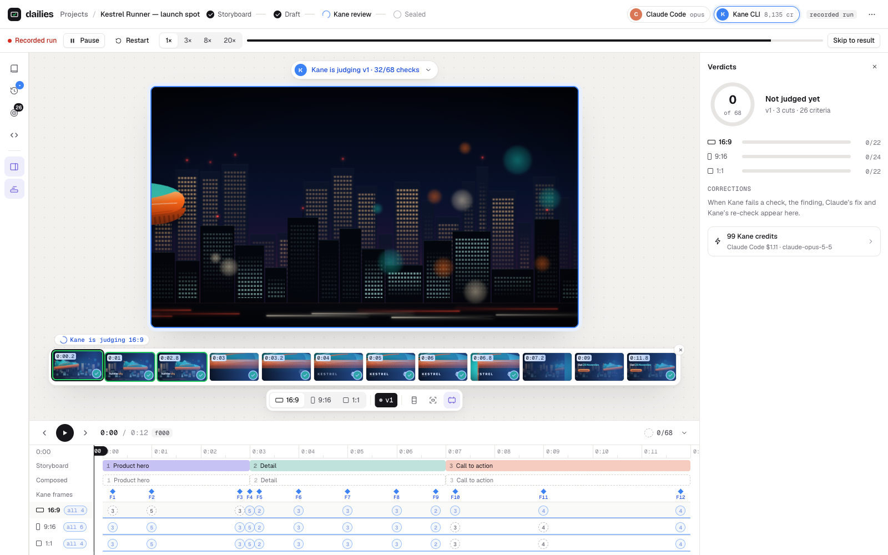

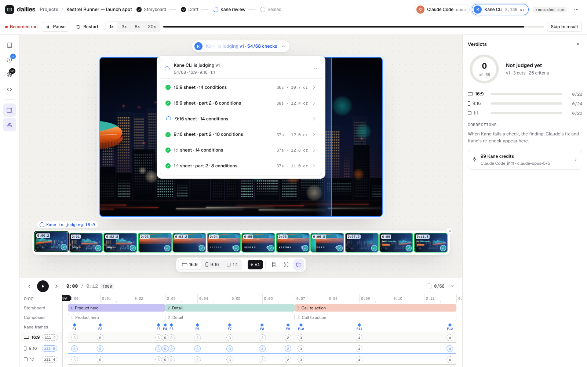

**4. If Kane fails something, watch the loop.**
- The pill turns red (“Kane blocked the stop”).
- Claude resumes its session and edits the code, and the player hot-swaps.
- Claude tries to stop, the Stop hook pins a new version, and Kane re-checks only what failed and then everything.
- Then the pill turns green.

The Verdicts panel shows each correction card. Expand it for Kane’s reason, the sheet’s measurement and Claude’s fix, and use **Before / After** to jump to the frames.


**5. Open Activity.** Use the clock icon in the left rail. Every Claude Code session (prompt, edits, cost) and every Kane CLI command is there, collapsed to one line. That includes the exact `--condition` strings with their verdicts, Kane’s NDJSON steps and the screenshot Kane judged.

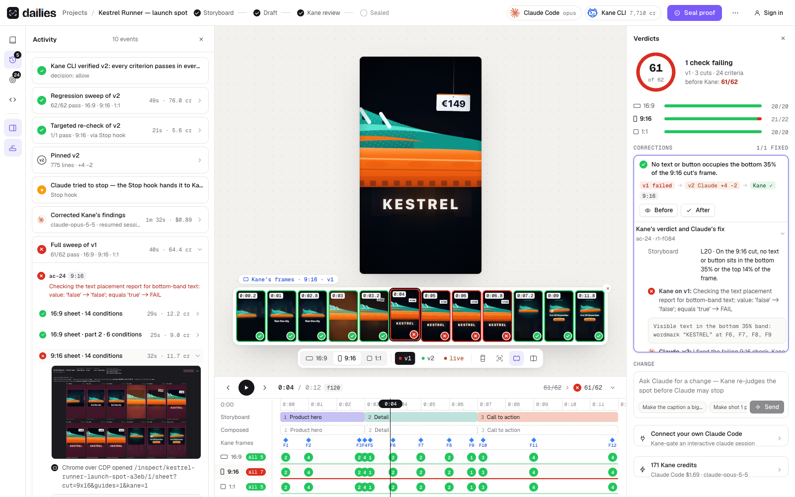

**6. Before vs after.** Use the split icon in the toolbar, or the ⋯ menu. The wipe sweeps in once, and the list below shows every criterion’s verdict on both versions.

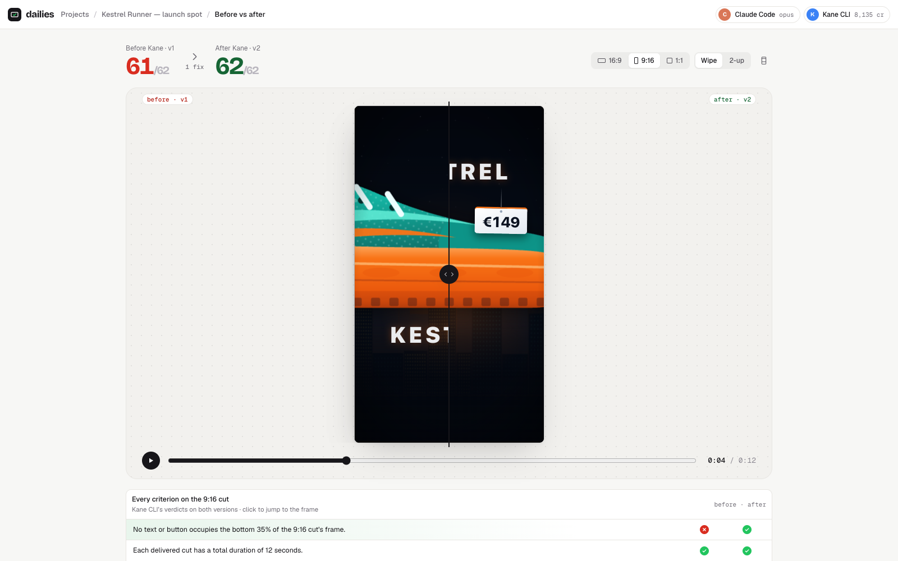

**7. Seal proof** (optional, roughly 400 credits the first time). Kane runs its own designed tests and `cover` reports coverage.

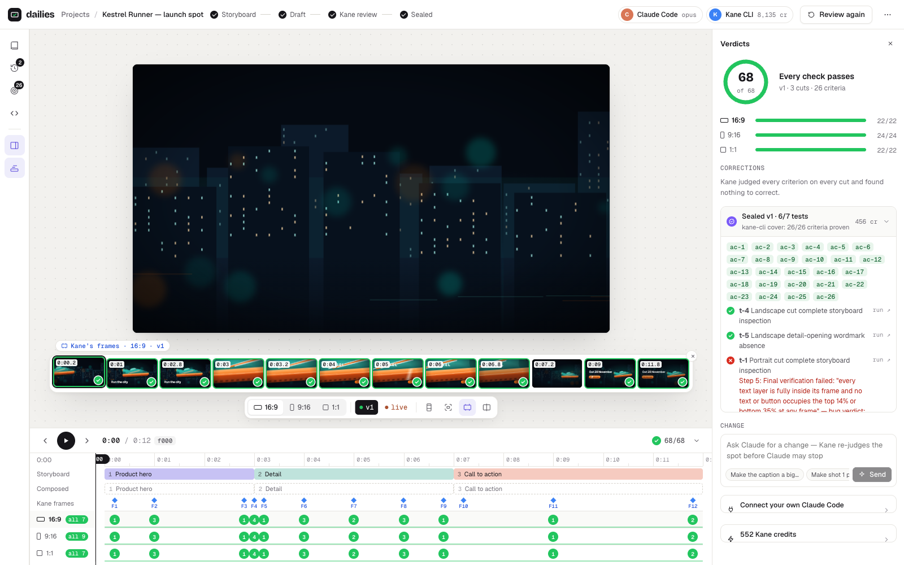

**No Claude Code or Kane login?** Use **Replay a recorded run** on the home page, which plays a real run with its real timing, or build the static replay (see [Recorded runs](#recorded-runs-and-the-static-replay)). Studio keyboard shortcuts:

| Key | Action |
| --- | --- |
| `Space` | play / pause |
| `←` / `→` | step one frame (`Shift` for one second) |
| `1`–`3` | switch cut |
| `Z` | safe zones |
| `X` | layer X-ray |
| `F` | Kane’s frames |
| `I` | verdicts panel |
| `[` | storyboard |

From the terminal, the same pipeline runs headless against a running server:

```bash
scripts/run-pipeline.sh            # demo storyboard: draft + Kane review
scripts/run-pipeline.sh --seal     # …and seal
```

## Built with

Built with **Claude Code** (model **Claude Opus 5.5**) as the coding agent. The studio’s own drafting agent is also Claude Code, run headless.

| Tool | Role |
| --- | --- |
| **Kane CLI** 0.10.5 | Designs the tests (`context`, `design`), judges every cut (`run --analyzer-only --cdp-endpoint`), seals evidence (`testmd run`, `cover`) |
| **Claude Code** (`claude -p`, stream-json, partial messages) | Writes and corrects `src/Video.tsx`; its Stop hook is the closed loop |
| **Remotion** 4 (`remotion`, `@remotion/player`) | Plays compositions and renders exact frames (`Thumbnail`) for the contact sheets and the film strip |
| **React 19 + Vite** | The studio |
| **Fastify** | Job API, SSE event stream, Stop-hook endpoint |
| **esbuild** | Compiles each version of Claude’s composition into a module the studio imports at runtime |
| **playwright-core** | Only opens Chrome with a CDP port and navigates it to a sheet. Kane does the judging. |
| **Google Chrome** | The browser Kane judges in |
| **Geist, Geist Mono, Bricolage Grotesque** | The studio and pitch typography |

## Prerequisites

- Node.js 20+ and Google Chrome
- Claude Code installed and logged in (`claude --version`)
- Kane CLI installed and logged in: `npm i -g @testmuai/kane-cli && kane-cli login`
- macOS or Linux

## Quick start

```bash
npm install
npm run dev          # server :4100 + studio :5173
open http://localhost:5173
npm test             # storyboard parsing, frame sampling, criterion mapping (no credits)
npm run typecheck
```

## How it works

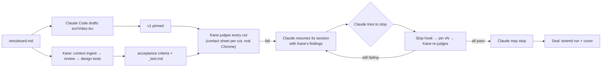

In plain English, end to end:

1. **You write the storyboard.** Shots with timecodes, exact copy, cuts and constraints, in markdown.
2. **dailies lays out a workspace.**
   - `storyboard.md`.
   - A `CLAUDE.md` contract: Remotion only, one component for every cut, and every text layer named with `data-layer`.
   - A `surface.md` describing the inspection pages.
   - A `.claude/settings.json` Stop hook.
3. **Claude Code drafts.** `claude -p` runs in the workspace with `--include-partial-messages`. The studio shows the code as it is typed and hot-swaps the player on every edit.
4. **Kane designs the tests at the same time.** Ingest, approve, design: acceptance criteria with oracles, scenarios and `*_test.md` files.
5. **The draft is pinned as v1.** It is compiled with esbuild, and every verdict is tied to a pinned version.
6. **Kane judges.**
   - For each cut, dailies opens a contact sheet in a Chrome with a CDP port. The sheet holds every storyboard timecode in one viewport, plus a facts table measured in the browser.
   - Kane answers every criterion for that cut in one `--analyzer-only` call.
   - Cuts run in parallel.
7. **Claude corrects.** Failures resume Claude’s draft session with:
   - Kane’s verdicts and the storyboard lines they cite;
   - the sheet’s measured evidence;
   - the path to Kane’s screenshot.
8. **The Stop hook closes the loop.** Every attempt to stop pins a new version. Kane re-judges only what failed, then sweeps everything for regressions. Failures go back as the hook’s block reason.
9. **Seal.** Kane runs its own designed tests and `cover` reports coverage.

## Kane CLI at the core

Everything that decides whether a frame is right is Kane CLI. dailies opens pages and keeps score.

### Command map

| Kane CLI | When | Source |
| --- | --- | --- |
| `whoami`, `balance`, `--version` | Studio health, credit display | [`kane.ts`](apps/server/src/kane.ts) `kaneIdentity` |
| `context ingest storyboard.md --as storyboard --mode agent` | Generate (in parallel with Claude) | [`plan.ts`](apps/server/src/plan.ts) `buildPlan` |
| `context ingest surface.md --as surface --mode agent` | Generate | same |
| `context list --all --json` | Read use-cases, criteria, scenarios, gaps | same |
| `context review --approve <uc…> --mode agent` | Promote extracted use-cases to trusted | same |
| `design tests --use-case <uc> --mode agent --max 8` (resumed if paused) | Criteria, scenarios, `*_test.md` | same |
| `maintain reconcile --from storyboard.md --source-id storyboard --mode agent` | Storyboard edited after planning | same |
| `run --analyzer-only --agent --cdp-endpoint http://127.0.0.1:<port> --condition …×N` | Every verification round, one call per cut | [`kane.ts`](apps/server/src/kane.ts) `analyze`, [`verify.ts`](apps/server/src/verify.ts) `runRound` |
| `testmd run .testmuai/tests/<t>_test.md --agent --headless --on-lock-conflict wait` | Seal | [`pipeline.ts`](apps/server/src/pipeline.ts) `startSeal` |
| `cover --json` | Seal: proven vs owed per criterion | same |

Every process is spawned with `shell: false` and `KANE_CLI_USER_AGENT=dailies`. Its NDJSON is parsed line by line and streamed into the studio ([`kane.ts`](apps/server/src/kane.ts) `kane`).

### Plan: the storyboard becomes a test suite

Kane’s design engine needs to know *where* a requirement can be observed. Given only the storyboard, it correctly refuses to invent a surface. In the first spike it produced 21 acceptance criteria and five scenarios, but every test was blocked by a `gap` (“Portrait preview surface”).

So dailies ingests a second source, [`surface.md`](apps/server/src/templates.ts), which is the contract of the inspection page. With it, Kane’s designed tests open real pages:

```markdown
## Step 1 @verifies ac-8, ac-9
Open {{sheet_url}}?cut=9x16 in the browser and wait for the contact sheet header to say ready;
read its vertical-cut header, then assert duration is 12 seconds and frame rate is 30 fps.
```

`{{sheet_url}}` lives in `.testmuai/variables/assurance.json`, and dailies points it at the version being sealed. The Criteria drawer shows each criterion with:

- its oracle (`equals €149`) and risk;
- the storyboard line it maps to;
- its verdict on every cut;
- the designed tests whose steps `@verifies` it.

### Judge: one contact sheet per cut

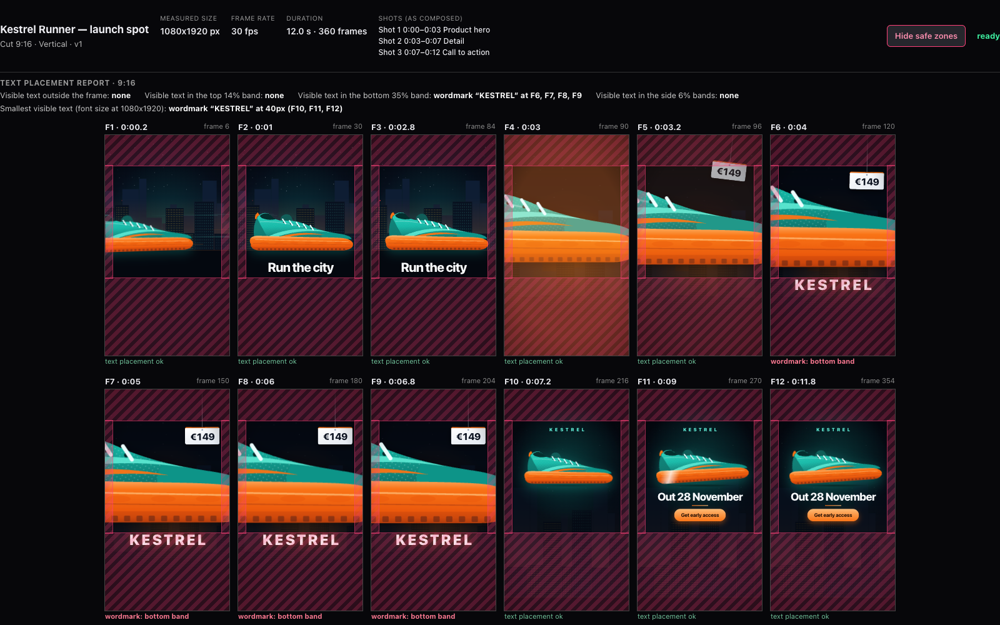

`/inspect/<project>/<version>/sheet?cut=9x16` ([`Inspect.tsx`](apps/studio/src/pages/Inspect.tsx)) is the page Kane looks at. Its styles live in their own [`sheet.css`](apps/studio/src/sheet.css), so restyling the studio can never change what Kane sees. It contains:

- **Header:** measured pixel size, fps, duration, and the shots as the composition declares them.
- **Text placement report:** every *visible* text layer that leaves the frame or touches a reserved band, plus the smallest text size on the cut.
- **Frames:** one Remotion `Thumbnail` per storyboard timecode, sized so the whole cut fits one screenshot.
  - Sampled frames: the opening and close of each shot, and every moment the storyboard names (“by 0:05”).
  - Each frame is labelled `F4 · 0:03` and has a flag line.
- **Facts table** (below the fold, read from the DOM): layer, kind, rendered text, visible, fully inside frame, touches top/bottom/side band, font size, box. Text is measured by its glyphs (a DOM `Range`), not its element box.
- `data-ready="true"` once every frame has rendered.

dailies opens that page in a headless Chrome with a CDP port, then runs:

```bash
kane-cli run --analyzer-only --agent --cdp-endpoint http://127.0.0.1:9342 \
  --condition "[ac-24] No text or button occupies the bottom 35% of the 9:16 cut's frame. This sheet shows only the 9:16 cut (1080x1920)…" \
  --condition "[ac-14] The shot 2 price tag reads exactly “€149”. … Read exact wording from the facts table Text column…" \
  …
```

`condition_results` come back as `true | false | null` with Kane’s reason for each, and dailies maps them to pass / fail / unjudged. The conditions are built in [`criteria.ts`](packages/shared/src/criteria.ts) `conditionFor`. Each one carries the criterion text verbatim, the frames that matter, and which instrument on the page to trust.

Why the facts table: in a spike, Kane’s vision read a hero image saying **“Run the ctiy” as “Run the city”** three times out of three. Overlay text in a composition is real DOM text, so exact-copy criteria are judged from strings, not pixels. Vision is used where it is strong: what a frame shows, colour, and whether something is visible.

### Accuracy vs credits

| Choice | Effect |
| --- | --- |
| One contact sheet per cut | Every criterion for that cut in **one** analyzer call |
| Facts table + placement report | Exact copy and positions read as strings, no OCR retries |
| Cuts judged in parallel (one Chrome per cut) | A full sweep of 62–69 checks in 40–58 s |
| Targeted re-check after a fix | Only the failed checks are re-judged (one condition: 4–6.5 credits, 9–21 s) |
| Regression sweep only when the targeted checks pass | Catches what a fix broke, once |
| Seal is opt-in | Authoring Kane’s own tests is the expensive step; replays are free |

Measured on the showcase run ([`docs/kane-runs/kestrel-runner-launch-spot-a3eb`](docs/kane-runs/kestrel-runner-launch-spot-a3eb/README.md)):

| Round | Kind | Version | Pass | Kane calls | Credits | Time |
| --- | --- | --- | --- | --- | --- | --- |
| r1 | full sweep | v1 (Claude’s draft) | 61/62 | 6 | 64.4 | 40 s |
| r2 | targeted | v2 (Claude’s fix) | 1/1 | 1 | 5.6 | 21 s |
| r3 | regression | v2 | 62/62 | 6 | 76.0 | 49 s |

Designing the 24 criteria and 5 tests from the storyboard cost 25 credits. A full sweep costs about one credit per check: every criterion on every cut, judged in a real browser.

### Correct: the Stop-hook loop

Every workspace has `.claude/settings.json`:

```json
{ "hooks": { "Stop": [{ "hooks": [{ "type": "command", "command": "node …/packages/hook/stop.mjs", "timeout": 1500 }] }] } }
```

[`stop.mjs`](packages/hook/stop.mjs) hands each stop attempt to the server ([`pipeline.ts`](apps/server/src/pipeline.ts) `onStopHook`), which:

1. pins `src/` as a new version (if nothing changed, it tells Claude it hasn’t fixed anything yet);
2. refuses to judge code that does not compile, and says why;
3. has Kane re-judge only the failed checks (**targeted**), then everything (**regression**) once those pass;
4. answers with Claude Code’s contract: `{"decision":"block","reason":"<what Kane saw>"}` keeps Claude working, and an empty answer lets it stop;
5. caps the loop (`DAILIES_MAX_FIX_ROUNDS`, default 4) and fails **open** on infrastructure errors, so a broken Chrome never traps the agent.

The block reason Claude receives is built in [`templates.ts`](apps/server/src/templates.ts) `correctionPrompt`. It lists each failing criterion with Kane’s words, the storyboard line it cites, and the sheet’s measured placement report. It also gives the path to Kane’s screenshot, which Claude opens with its own `Read` tool to see exactly what Kane saw.

Claude Code is spawned with `--setting-sources project --strict-mcp-config --tools Read,Edit,Write,Glob,Grep`. Only the workspace’s hook applies, never the user’s global hooks or MCP servers.

### Ask for a change, connect your own Claude Code

- **Ask Claude for a change** (Verdicts panel, then Change). Your request is passed to Claude’s session *verbatim*, with no reminder of the rules. The Stop hook then runs a full Kane sweep before Claude may finish ([`pipeline.ts`](apps/server/src/pipeline.ts) `startRevise`).
- **Connect your own Claude Code.** Toggle it in the Verdicts panel and run `cd workspaces/<project> && claude` in a terminal. The toggle writes `.dailies-gate`, and the same Stop hook then gates *your* interactive session: it can’t end its turn until Kane passes the cut. The rounds show up live in the studio ([`pipeline.ts`](apps/server/src/pipeline.ts) `onGatedStop`).

### Seal: Kane’s own tests and coverage

**Seal proof** runs every Kane-designed `_test.md` with `kane-cli testmd run` against the final version. The tests run one at a time because they share the workspace’s store lock. For each test, dailies keeps its TestMu share link and the reason for its first failing step, from `output-<test>/Result.md`. It then runs `kane-cli cover --json`, and the sealed card shows each criterion’s coverage state (`proven`, `failing`, `not_designed`).

### NDJSON, exit codes and credits

- `run --analyzer-only`: verdicts come from `run_end.condition_results` and `condition_reasons`. Exit 0 means the conditions were *judged*, not that they are *true*.
- `testmd run`: the verdict comes from `test_md_done.overall_status`, not the first `run_end`.
- Assurance commands (`--mode agent`) stream `agent_activity`, `usage`, `commit`, `receipt`, `session_paused` and `done` into the Activity view. A `session_paused` is answered with Kane’s own recommended defaults.
- Credits are read from `run_end.credits_consumed` **or** `credits`, and from assurance `usage.total_credits`, because Kane versions disagree on the field name.

## The failure Kane catches

Everything below is real output from the recorded run [`kestrel-runner-launch-spot-a3eb`](docs/kane-runs/kestrel-runner-launch-spot-a3eb/README.md) (Claude Code `claude-opus-5-5`; Kane CLI 0.10.5). Nothing was planted.

Claude’s one-shot draft looks finished in every cut. But on the **9:16** cut, in shot 2, it parks the **KESTREL** wordmark in the bottom 35% of the frame, exactly where Reels and TikTok draw their caption and buttons. The contact sheet Kane judged reported it:

```text
TEXT PLACEMENT REPORT · 9:16
Visible text in the bottom 35% band: wordmark “KESTREL” at F6, F7, F8, F9
```

Kane failed the criterion it had derived from storyboard line 20:

```text
r1 · v1 · ac-24 @ 9:16 — FAIL
No text or button occupies the bottom 35% of the 9:16 cut's frame.
Checking the text placement report for bottom-band text: value: 'false' -> 'false'; equals 'true' -> FAIL
```

Claude’s session resumed with Kane’s verdict, the storyboard line, the sheet’s measured report and the path to Kane’s screenshot. Claude moved the wordmark out of the band (v2, +4 −2) and tried to stop. The Stop hook pinned v2. Kane re-judged the one failed check (pass, 5.6 credits), then everything (62/62), and released Claude:

```text
Kane CLI verified v2: every criterion passes in every cut.
```

In the studio this shows up in four places:

- the correction card in the Verdicts panel;
- frames F6–F9 outlined red on v1’s film strip;
- the 9:16 lane turning from red to green;
- **Before vs after** opening on F6 with the wipe between the two versions.

The other runs show the rest of the product honestly:

| Run | What happened |
| --- | --- |
| `kestrel-runner-launch-spot-a3eb` (recorded) | Draft 61/62. Kane caught the 9:16 band violation, Claude fixed it, final 62/62 |
| `kestrel-runner-launch-spot-30d2` (recorded) | Draft 65/65 on the first sweep. **Sealed:** 7/7 Kane-designed tests passed, `cover` 25/25 criteria proven |
| `ledgerline-instant-exports-0525` (recorded) | Feature-announcement spot. Draft 33/33, nothing to correct |
| `kestrel-runner-launch-spot-477c` (recorded) | Three change requests, each gated by a full Kane sweep, 69/69 every time. Claude worked around the 9:16 rule itself, and Kane proved it |
| `kestrel-runner-launch-spot-9fc9` (26 Nov, demo storyboard) | Draft 68/68. Sealed: 6/7 designed tests passed (one failed; reason shown in the sealed card) |
| `kestrel-runner-launch-spot-5fe1` (26 Nov, demo storyboard, new UI) | Draft 68/68 in a 43 s sweep |

## How this meets the brief

- **Ships.** A working studio: a storyboard goes in, and a playable, verified composition comes out in three cuts. One click starts the demo, and recorded runs replay with no install.
- **Verified.** Kane exercised every cut of every version: 125 checks in 13 analyzer calls on the showcase run alone, plus sealed runs where Kane’s own designed tests proved 25/25 criteria. It caught a real defect in Claude Opus 5.5’s one-shot draft (text inside the 9:16 bands the platform covers) and proved the fix. The rounds, conditions, verdicts and Kane’s screenshots are committed.
- **Closed loop.** Claude Code’s Stop hook *is* the loop: Claude tries to stop, Kane re-judges, the failure becomes the block reason, Claude edits, and Kane judges again. The studio shows that moment live, and the same hook gates a developer’s own `claude` session.
- **Craft.** Kane isn’t testing an app here; it’s reviewing what an agent *made*. The craft is in:
  - the contact sheet, and the facts table that keeps Kane honest about exact copy;
  - the credit strategy;
  - the composing view, where Claude’s code and Kane’s criteria arrive side by side;
  - a light editor whose timeline pins and film strip are Kane’s verdicts.

## The studio

| Surface | What it shows |
| --- | --- |
| **Home** | One-click demo, a live mini editor rendered from a real run, and projects with their before → after score |
| **New spot** | Storyboard editor (★ demo template preselected) with a live preview of what dailies parses and which frames Kane will judge |
| **Studio**: top bar | Stepper, the two agents (pulsing while they work), the primary action, and the ⋯ menu (before vs after, review again, seal, open Kane’s contact sheet) |
| **Studio**: canvas | Player; while drafting, a side-by-side composing view; then the status pill with its live trace, Claude’s code card, the shimmering scan while Kane judges, Kane’s film strip with per-frame verdicts, and a floating toolbar (cut, versions, live, safe zones, X-ray, frames, before/after) |
| **Studio**: timeline | Ruler with an ink playhead, storyboard shots vs composed shots, Kane’s sampled frames, one lane of verdict pins per cut |
| **Studio**: rail drawers | Storyboard (lines lit by their criteria’s verdicts), Activity (every Claude session and Kane run, collapsible down to the exact conditions and NDJSON steps), Criteria, Code diff |
| **Studio**: Verdicts panel | Score ring, per-cut bars, correction cards (details collapsed), sealed proof, change requests, the Claude Code gate, credits |
| **Before vs after** | Wipe or 2-up in lock-step, scores, and every criterion’s verdict on both versions |
| **Contact sheet** | The page Kane judges |
| **Pitch** | `/pitch`: 12 slides, with numbers read from the showcase run |
| **Brand** | `/brand`: the brand kit, with downloads |

## Brand

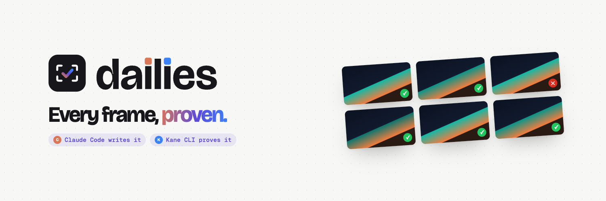

The mark is a **viewfinder holding a check**: the frame Claude Code composes, proven by Kane CLI. In the wordmark, the two i-dots are the two agents: clay for Claude Code and cobalt for Kane CLI. That colour pairing runs through the studio, the pitch and the film, and verdicts are always colour plus an icon.

- `node brand/src/build.mjs` generates every vector asset. The wordmark is real outlines of Bricolage Grotesque 700 (via opentype.js), so it renders the same everywhere. The outputs are `brand/svg/*`, `apps/studio/public/brand/*` and `packages/shared/src/brand.ts`, the geometry used by the studio, the pitch and the film.
- `node brand/src/social.mjs` renders the rasters: X avatar (400×400) and banner (1500×500), Open Graph card, film end card, and 1024/2000 px logo PNGs.
- [`/brand`](https://daohbofm7o9ia.cloudfront.net/brand) is the brand page: usage, colour, type, rules and downloads.

## The film

[`video/`](video/) is a Remotion project that renders the 2:13 film: the pitch first, then a walkthrough recorded from the real app.

| Step | How |
| --- | --- |
| Script | [`video/script.json`](video/script.json): 17 lines, from the problem (*AI code got tests, AI video got vibes*) to Kane’s next frontier |
| Voice | ElevenLabs `eleven_multilingual_v2` with **character timestamps** (`node video/src/voice.mjs`). Every word on screen and every camera move is timed to the narration |
| Music and SFX | ElevenLabs sound generation: two looping beds, a riser, whooshes, verdict chimes |
| App footage | `node video/src/record.mjs`: Chrome’s CDP screencast at 1920×1080 (JPEG q92, ~43 fps captured) with an injected cursor. It replays the recorded run with phase-aware speed ramps, so every frame is the real studio |
| Stills | `node video/src/stills.mjs`: native-size frames of the showcase composition (`/still/:id/:v`) |
| Edit | [`video/src/Ad.tsx`](video/src/Ad.tsx): 17 scenes, each driven by the narration’s word timings ([`timeline.ts`](video/src/timeline.ts)) |
| Render | `node video/src/render.mjs`: H.264 CRF 16, mastered to −14 LUFS |

## Deploy (AWS)

The live site is the static replay build on **S3 + CloudFront**:

- a private bucket with origin access control;
- HTTPS only, HTTP/3 and compression;
- SPA fallback to `index.html`;
- immutable caching for hashed assets, `no-cache` for `index.html`.

A small Lambda ([`infra/deployer/deployer.py`](infra/deployer/deployer.py)) unpacks each site bundle with the right `Content-Type` and `Cache-Control`, prunes stale files and invalidates the distribution:

```bash
scripts/deploy.sh          # build the static studio and deploy it
scripts/deploy.sh --film   # …and upload video/out/dailies-ad.mp4 to /media/
```

The build refuses to deploy if it contains this machine’s home path. Recorded runs are exported with project-relative paths.

## HTTP API

| Method | Path | Role |
| --- | --- | --- |
| `GET` | `/api/health` | Claude Code version, Kane version, user, credits |
| `GET` / `POST` | `/api/projects` | List / create from a storyboard |
| `GET` / `PATCH` | `/api/projects/:id` | Project / title, gate |
| `PUT` | `/api/projects/:id/storyboard` | Edit the storyboard |
| `POST` | `/api/projects/:id/draft` · `review` · `seal` · `cancel` | Run a stage |
| `POST` | `/api/projects/:id/revise` | Kane-gated change request |
| `GET` | `/api/projects/:id/events` | SSE (history, then live) |
| `GET` | `/api/projects/:id/events.json` | Full event log |
| `GET` | `/api/projects/:id/module/:v` | Compiled composition (version number or `live`) |
| `GET` | `/api/projects/:id/source/:v` · `diff/:a/:b` | Source and diffs |
| `GET` | `/api/projects/:id/files/eye/*` | Kane’s-eye screenshots |
| `GET` | `/api/projects/:id/tests` | Kane-designed `_test.md` files |
| `POST` | `/api/hook/stop` | Claude Code Stop hook |

## Recorded runs and the static replay

Every event is appended to `workspaces/<id>/runs/events.ndjson`. [`scripts/export-recorded.ts`](scripts/export-recorded.ts) exports a finished run to `apps/studio/public/recorded/`: the project, its events, compiled versions, diffs, Kane’s-eye screenshots and designed tests. It also writes readable evidence to `docs/kane-runs/<id>/`. Then:

```bash
VITE_DAILIES_STATIC=1 npm run build && npx vite preview apps/studio
```

builds a static studio that replays the run with its real rhythm (play, 1×–20×, skip to result). Watching it needs no Claude Code, Kane CLI or server. Locally, any project can also be replayed with `/p/<id>?replay=1`.

## Honesty: limitations

- **Kane sees frames, not motion or sound.** It judges sampled frames: every timecode the storyboard names, plus each shot’s opening and close. A glitch between two sampled frames can slip through, and audio is out of scope.
- **The facts table is dailies’ own measurement.** It is the browser’s real layout (`getBoundingClientRect`, a DOM `Range` for glyphs, computed font size), but dailies wrote the code that reads it. Kane judges each criterion against both the table and the picture. Vision alone was not reliable for exact copy: in a spike it read “Run the ctiy” as “Run the city” three times out of three.
- **Kane is not infallible, and neither was the first version of the sheet.**
  - In early runs, Kane passed a 9:16 safe-zone criterion that the facts contradicted, and failed a “three cuts’ dimensions” criterion on a one-cut sheet. Both came from ambiguous instruments and conditions. Those are now fixed with per-band columns, a placement report, and conditions that say “judge only this cut”.
  - Element-box measurement once reported a centred caption as touching the side bands. Text is now measured by its glyphs.
  - In one unrecorded run, a regression sweep failed “all text stays inside the frame” on the 1:1 cut while the sheet’s own report said no text left the frame. Claude was sent back once more for a likely false positive. The correction prompt includes the measured report, so Claude can see the contradiction, and the round cap bounds the cost.
- **One-shot drafts are not always wrong.** Kane failed four of the first six launch-spot drafts on their first sweep: three put text inside the 9:16 platform bands, and one missed the €149 tag at 0:06. Two were clean, and the 26 November drafts of the demo storyboard were clean too (68/68 twice). When asked for changes that pressure the rule, Claude worked around it by itself. The value is that you don’t have to watch the video to find out which kind of run you got.
- **A designed test can be stricter than the storyboard.** In one seal, Kane’s own test asserted the price tag on the 0:03 frame, but the storyboard only requires it at 0:04 and 0:06. The test failed for a reason that wasn’t the video. The sealed card shows each test’s failing step and Kane’s reason so you can tell the difference.
- **Seal is the expensive step.** Authoring Kane’s own tests costs about 400–455 credits for 7 tests on the launch spot. Replays are free, and the review loop is cheap by comparison (see [Accuracy vs credits](#accuracy-vs-credits)).
- **Kane runs locally.** It needs Chrome and a Kane login, so a hosted studio replays recorded runs instead of running Kane.
- **Compositions are limited to React + Remotion**, with no external assets, so dailies can compile and render every version deterministically.

## Configuration

See [`.env.example`](.env.example).

| Variable | Default | Purpose |
| --- | --- | --- |
| `DAILIES_PORT` | `4100` | API port |
| `DAILIES_STUDIO_URL` | `http://localhost:5173` | Where Kane’s Chrome opens the sheets |
| `DAILIES_CLAUDE_MODEL` | `opus` | Model for the drafting agent |
| `CHROME_PATH` | system Chrome | Browser for the sheets |
| `DAILIES_CDP_PORT` | `9341` | First CDP port (one per cut) |
| `DAILIES_MAX_CONDITIONS` | `14` | Conditions per analyzer call before a sheet is split |
| `DAILIES_MAX_FIX_ROUNDS` | `4` | Stop-hook rounds before handing back to a human |

## Repository layout

```text
apps/server            Fastify API, Claude Code runner, Kane runner, verification rounds, Stop-hook endpoint
apps/studio            React studio, contact sheet (sheet.css), before/after, pitch
packages/shared        Storyboard parser, frame sampling, criterion mapping, Kane condition builder (+ tests)
packages/hook          Claude Code Stop hook (stop.mjs)
scripts                export-recorded.ts, run-pipeline.sh, deploy.sh
brand                  Logo, wordmark and social assets (generated: src/build.mjs, src/social.mjs)
video                  The film: script, voiceover, recordings, Remotion edit, renderer
infra/deployer         Lambda that unpacks site bundles into S3 and invalidates CloudFront
workspaces/<id>        One per project: storyboard, CLAUDE.md, surface.md, src/, versions/, runs/, .testmuai/ (gitignored)
docs/kane-runs         Committed Kane evidence from the recorded runs
docs/media             README screenshots
docs/design-refs       UI references the editor design was based on
```
